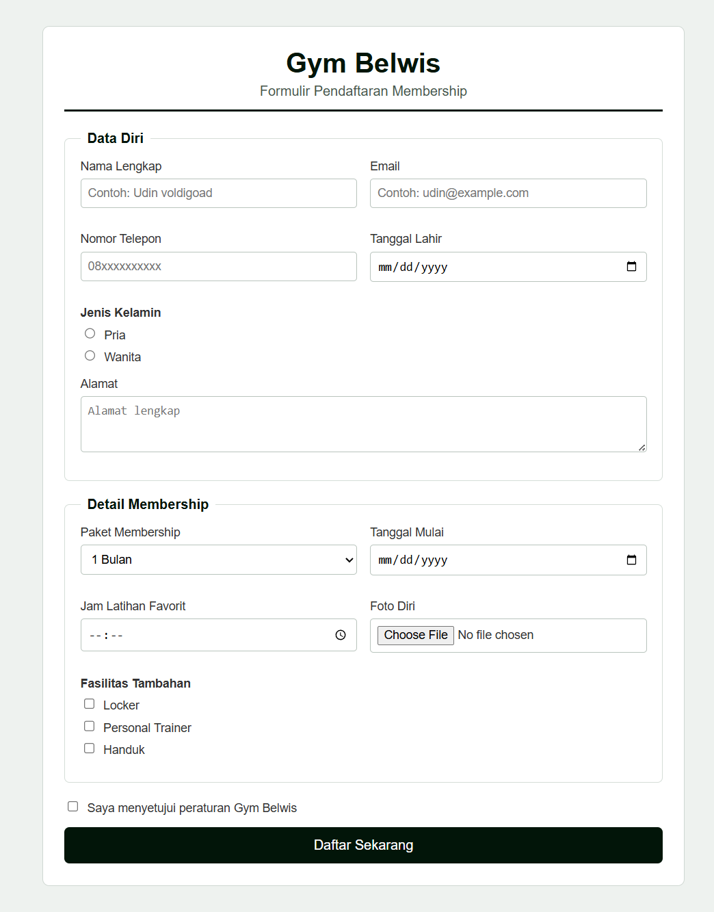
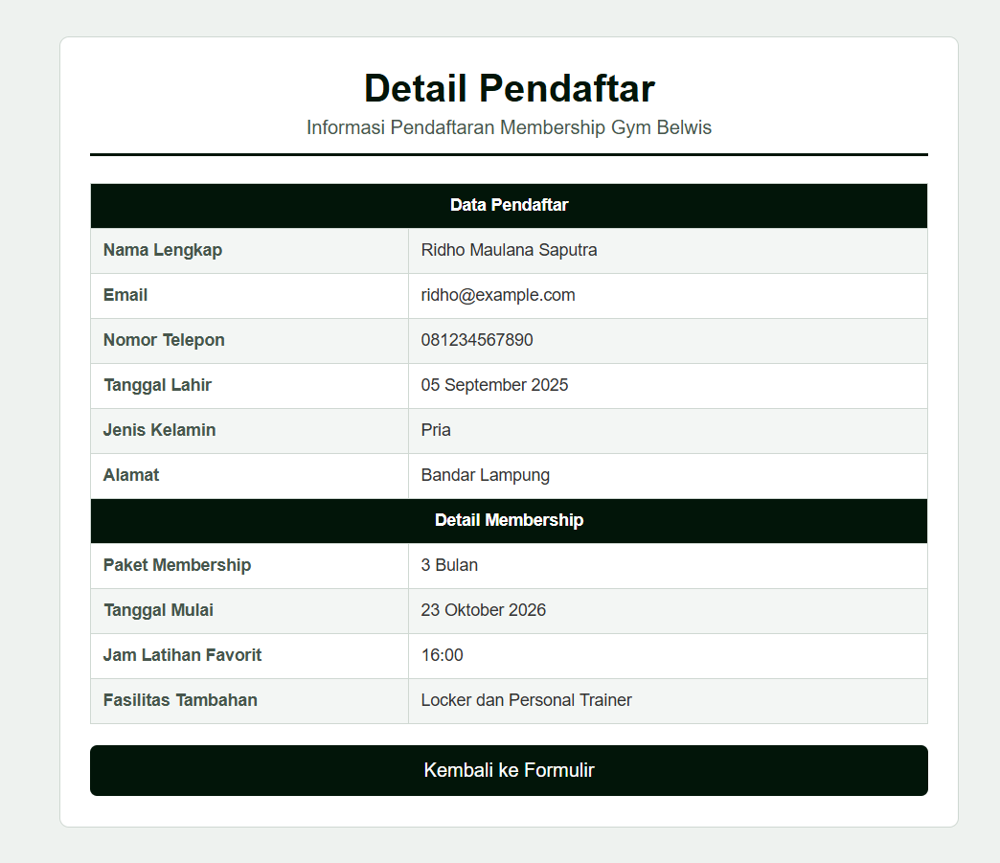

# Task 3 - Pendaftaran Membership Gym Belwis

## Deskripsi

Task 3 adalah website sederhana untuk pendaftaran membership Gym Belwis.
Website ini dibuat menggunakan HTML dan CSS. Pengguna dapat mengisi data diri,
memilih paket membership, menentukan tanggal mulai dan jam latihan, serta
memilih fasilitas tambahan.

## Halaman Website

### Halaman Formulir Pendaftaran

Halaman utama berada pada [`index.html`](./index.html). Halaman ini menyediakan
formulir dengan bagian berikut:

- Data diri: nama lengkap, email, nomor telepon, tanggal lahir, jenis kelamin,
  dan alamat.
- Detail membership: paket membership, tanggal mulai, jam latihan favorit, dan
  foto diri.
- Fasilitas tambahan: locker, personal trainer, dan handuk.
- Persetujuan terhadap peraturan Gym Belwis.



### Halaman Detail Pendaftar

Halaman detail berada pada [`detail.html`](./detail.html). Halaman ini
menampilkan ringkasan data pendaftar dan detail membership dalam bentuk tabel.



## Teknologi yang Digunakan

- HTML5
- CSS3
- CSS Grid
- HTML form validation
- Media query untuk tampilan responsif

## Struktur Berkas

```text
task_3/
├── index.html
├── detail.html
├── style.css
├── docs/
│   ├── index-screenshot.png
│   ├── detail-screenshot.png
│   └── laporan_task_3.pdf
└── README.md
```

## Cara Menjalankan

1. Buka folder `task_3`.
2. Buka file [`index.html`](./index.html) menggunakan browser.
3. Isi formulir pendaftaran.
4. Tekan tombol **Daftar Sekarang** untuk membuka halaman detail.

## Catatan Implementasi

Formulir menggunakan metode `GET` dan diarahkan ke `detail.html`. Halaman
detail saat ini menampilkan data contoh secara statis. Pengembangan berikutnya
dapat menambahkan JavaScript agar data dari formulir diteruskan dan ditampilkan
secara dinamis, kemudian menyimpan data ke database.

## Dokumentasi

Laporan program tersedia pada
[`docs/laporan_task_3.pdf`](./docs/laporan_task_3.pdf).

## Repository

[https://github.com/udinvoldigoad/Tugas_PAW_RA.git](https://github.com/udinvoldigoad/Tugas_PAW_RA.git)
